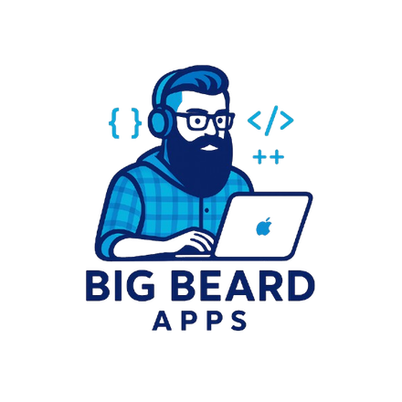

  

<h1 align="center">Big Beard Apps</h1>

<em>Independent iOS apps, built with care.</em>

One-person studio run by [Raul Peña](https://bigbeardapps.com/about.html) out of Georgetown, Texas — Air Force veteran, real estate broker, self-taught engineer. Every app is built on one idea: **your data belongs on your device.** No ads, no tracking, no accounts, nothing sold to anyone.

## The apps

| App | What it does | Status |
|---|---|---|
| 🍽️ **[Feastmark](https://bigbeardapps.com/feastmark/)** | Turns recipe videos from Instagram, TikTok, and YouTube into your personal cookbook — even when the recipe is only spoken aloud. | **[Live](https://apps.apple.com/app/feastmark-save-any-recipe/id6762322193)** |
| 📊 **[PayoffPilot](https://bigbeardapps.com/payoffpilot/)** | A private debt-payoff planner. Compare Snowball vs. Avalanche with your real numbers — pay once, never subscribe. | **[Live](https://apps.apple.com/app/payoffpilot/id6753783449)** |
| 🎣 **[ReelTalk](https://bigbeardapps.com/reeltalk/)** | 30 original fishing-pun stickers for iMessage. Big bass energy for your group chats. | Approved — September 1 |

## Building in the open

- 📖 [Build log](https://bigbeardapps.com/about.html) — notes from the journey
- 🗺️ [PayoffPilot roadmap](https://bigbeardapps.com/payoffpilot/roadmap.html) — Now / Next / Later, no fake dates
- 📰 [Press kit](https://bigbeardapps.com/press/) — everything you need to write about the apps

## Say hi

[bigbeardapps.com](https://bigbeardapps.com) · [X](https://x.com/BigBeardApps) · [Mastodon](https://mastodon.social/@BigBeardApps) · [Bluesky](https://bsky.app/profile/bigbeardapps.bsky.social) · [Contact](https://bigbeardapps.com/contact.html)
